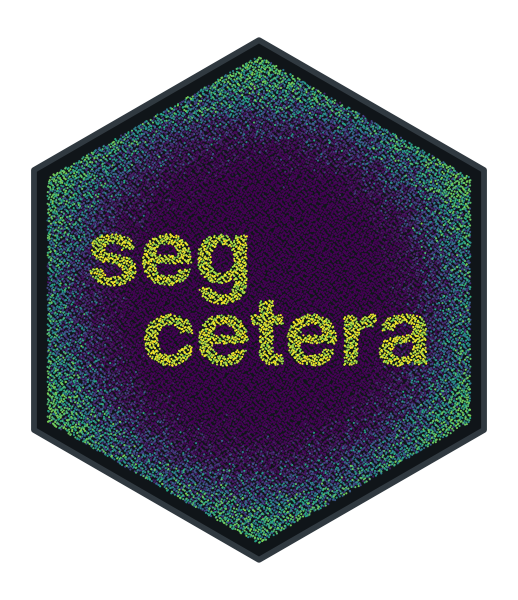

# segcetera 



**segcetera** is an R package for measuring segregation in individual records,
small-area population counts, and networks. It implements categorical, ordinal,
and continuous segregation measures based on the work of Reardon and colleagues,
with a common interface for analyzing segregation in geographic and network data.

Use it to study how segregation changes with neighborhood scale, describe the 
population surrounding each location, rasterize your population, perform repeated 
measures over time, and calculate groups' exposures to one another. 

Importantly, segcetera is designed with speed and efficiency in mind. The goal 
has been to enable workflows for population scale data sets, with records 
that span multiple, repeated measurement instances.

segcetera supports:

- Dissimilarity, information theory, relative diversity, and n-root indices,
  plus exposure and isolation summaries.
- Fixed-distance and population nearest-neighbor neighborhoods, with spatial
  weighting options.
- Regular-grid searches that reuse offsets and radius weights across locations.
- Analysis of several variables in one call, sharing neighborhood searches.
- Local population compositions and continuous-rank summaries, with tabular and
  spatial outputs for downstream uses.
- Rasterization and pycnophylactic smoothing of polygon population data.
- Neighborhoods defined by network hops or travel costs.

## Installation

Install the development version from the `develop` branch on GitHub:

```r
install.packages("pak")
pak::pak("bfjarvis/segcetera@develop")
```

segcetera requires R 4.2 or later. The GitHub installation compiles C++ code and
installs dependencies, including `sf` and `terra`. When updating an installation,
restart R before loading the updated package.

The package is in pre-1.0 development. Once a CRAN release is available, its
installation command will be:

```r
install.packages("segcetera")
```

The examples below use tidyverse for data preparation and extraction:

```r
install.packages("tidyverse")
```

## A first analysis

Each row in this small example represents a person, with coordinates, a group,
an ordered education category, and an income. The coordinates are synthetic
planar units. For real geographic data, use a suitable projected coordinate system
so distances have a meaningful unit, such as meters.

```r
library(segcetera)
library(tidyverse)

people <- tibble(
  x = c(0, 0, 1, 1, 2, 2, 3, 3),
  y = 0,
  group = c("A", "A", "A", "B", "B", "B", "A", "B"),
  education = ordered(
    c("basic", "basic", "middle", "middle", "higher", "higher", "middle", "higher"),
    levels = c("basic", "middle", "higher")
  ),
  income = c(10, 15, 20, 30, 40, 60, 80, 100)
)

variables <- list(
  group = seg_categorical(vars = "group"),
  education = seg_ordinal(vars = "education"),
  income = seg_continuous(vars = "income")
)

result <- seg_measure(
  people,
  coords = c("x", "y"),
  variables = variables,
  neighbors = "radius",
  bands = c(1, 2),
  weighting = "biweight",
  measures = "all",
  output = "full"
)

result
```

`variables` argument, a user specifies the categories, statuses, resources etc. 
to be analyzed. Each `vars` argument
selects one observed-value column or multiple category-count columns.
`bands` sets the neighborhood radii; the biweight kernel gives
nearer residents more weight. `measures = "all"` requests the scalar indices and
exposure summaries. `output = "full"` also retains local environments for inspection
and mapping.

For an `sf` object, pass it directly as the first argument; its active geometry
supplies the locations. Points use their coordinates. Raw polygons use interior
representative points from `sf::st_point_on_surface()` by default. Set `polygon_points = "centroid"`
to use polygon centroids. The same option is available in `seg_default_bands()`.

### Explore the results

Extract segregation indices as a tidy table:

```r
indices <- result |>
  as.data.frame(what = "indices") |>
  as_tibble()

indices |>
  select(variable, band, measure, value)
```

Compare values across scales within each variable and measure. The categorical,
ordinal, and continuous indices describe their respective kinds of variation.

Extract exposure to each group, averaged over members of each focal group:

```r
result |>
  as.data.frame(what = "exposure", variables = "group", bands = 2) |>
  select(reference, target, value)
```

The diagonal entries are isolation: a group's average exposure to itself.
Result tables use one numeric `value` column. Calculation metadata remains in
`result$analyses[[name]]$definition`; inspect status and kNN information separately
with `as.data.frame(result, what = "diagnostics")`.
For local environments, extract each location's neighborhood composition:

```r
result |>
  as.data.frame(what = "env", variables = "group", bands = 2) |>
  as_tibble()
```

Use `sf::st_as_sf(result, variables = "group", bands = 2)` to obtain the same
local summaries with geometry, ready for mapping. `what = "pairwise"` extracts
binary segregation indices between categorical/ordinal categories or resolved income groups.

For larger analyses, the default `output = "indices"` retains indices and grouped
exposures. Use `output = "localenv"` when the local environments are the desired
result.

`scope = "overall"` selects full-distribution indices, `"pairwise"` selects
two-group comparisons, and the default `"both"` includes both. Variable
constructors can override `scope`, `output`, `keep_scores`, and
`keep_contributions`; `NULL` inherits the global setting. Effective choices are
recorded in `result$analyses[[name]]$settings`.

### Choose a neighborhood

Use `neighbors = "radius"` for physical distance bands. For adaptive neighborhoods,
use `neighbors = "knn"` and give population thresholds:

```r
nearest <- seg_measure(
  people,
  coords = c("x", "y"),
  variables = variables,
  neighbors = "knn",
  bands = c(4, 8),
  weighting = "unweighted"
)
```

These thresholds count eligible people, including the focal population. With
aggregate count data, they count residents represented by the rows. Each variable
uses its own eligible population.

## Income and other continuous variables

`seg_continuous()` infers the input representation: numeric microdata use exact
values; ordered-factor microdata and multiple count columns use income intervals.
Supply `scores` with count columns when they represent exact observed values.
Explicit `levels` provide an order for interval memberships. The selected
representation is recorded in `result$analyses$income$definition$representation`;
use `representation = "exact"` or `"intervals"` to choose explicitly.

Continuous indices use the underlying income distribution. The `summary` option
chooses how to describe local environments and groups' experiences. The default
reports shares of the supplied categories for interval data and aggregate
counts, using those categories for exposure and pairwise indices. Numeric
microdata default to four global quartile groups. To request quantile groups
for either input, supply interior probabilities:

```r
seg_continuous(vars = "income", summary = list(probs = c(.2, .4, .6, .8)))
```

To describe the income ranks found at local quantiles, select quantile summaries:

```r
seg_continuous(
  vars = "income",
  summary = list(type = "quantiles", probs = c(.25, .5, .75), mean_rank = TRUE)
)
```

This reports global income ranks at each neighborhood's quartiles, plus its mean
rank. The same probabilities define the focal groups used to average those local
summaries. Extract the grouped profiles with `what = "exposure"`; the `statistic`,
`prob`, and `value` columns identify their meaning. These are averages of local
rank statistics, not exposure probabilities of encountering a target group.

For absolute income thresholds, use
`summary = list(type = "shares", cuts = c(30000, 60000))`.

## Aggregated population counts

For small-area tables, select multiple category-count columns with `vars`. This example
has two areas and three ordered income intervals:

```r
areas <- tibble(
  x = c(0, 1), y = 0,
  group_A = c(40, 10), group_B = c(10, 40),
  income_low = c(30, 10), income_middle = c(15, 20), income_high = c(5, 20)
)

area_result <- seg_measure(
  areas,
  coords = c("x", "y"),
  variables = list(
    group = seg_categorical(vars = c("group_A", "group_B")),
    income = seg_continuous(
      vars = c("income_low", "income_middle", "income_high")
    )
  ),
  bands = 0,
  weighting = "unweighted"
)
```

With these distinct area locations, `bands = 0` treats each area's own residents
as its local environment, giving non-spatial segregation across areas. Positive
distance bands combine nearby areas into spatial neighborhoods. Ordered-category
counts use `seg_ordinal(vars = c(...))` in the same way.

Long-form counts work too: select one membership column and use the count as a
weight, for example `seg_categorical(vars = "race", weights = "population_count")`.
Each row represents a neighborhood/category combination; rows in the same
neighborhood must share its coordinates or geometry. A neighborhood identifier
alone does not provide spatial locations. With multiple `vars`, the selected
columns already contain counts, so do not also supply `weights`.

For interval income, column order defines the income ordering. segcetera interpolates
in global-rank space. Summary groups default to the supplied income categories.
Explicit `summary$probs` proportionally allocates interval populations to the
requested quantile groups. A warning identifies when groups split supplied
intervals. The model assumes the same within-interval rank distribution at each
location; allocation fractions and local diagnostics are available in the result.
Extract the neighborhood diagnostics with `as.data.frame(result, what = "interpolation")`.

For polygon `sf` count data, `surface = "grid"` distributes population across a
fine grid before measuring neighborhoods. `surface = "pycno"` adds
pycnophylactic smoothing, preserving source-zone category totals through
rescaling. See the [surface guide](vignettes/segcetera-surface-construction.Rmd) for
resolution choices and count-conservation audits.

Search defaults to `"auto"`: grid offsets for regular lattices and constructed
grid surfaces, brute force for other radius searches, and boost for other kNN
or network searches. The chosen backend is recorded in `result$neighbors$engine`.
Boost can be faster for narrow radius neighborhoods; explicit `search = "boost"`
or `search = "brute"` lets you compare timings for your data. Known sparse
lattices can use explicit `search = "grid"` or specify their `grid_size`.

## Shared locations

People recorded at the same coordinates, such as 100 m grid-cell centroids,
share one spatial site. The engine combines their attribute distributions and
calculates one local environment per site. Population-kNN takes a proportional
fraction of the whole focal site's population when it exceeds the threshold.
Exact continuous values remain available to the calculation.

With `output = "full"` or `"localenv"`, `result$data` retains the input records
and `result$site` maps those rows to the site-level coordinates, geometries,
population totals, and local results. For example, expand one retained environment
back to the input records with:

```r
result$analyses$group$env[[1]][result$site, , drop = FALSE]
```

Identical polygon geometries likewise share a site. Distinct shapes retain their
own sites, even when their representative points coincide.

## Repeated measurements

For repeated measurements on the same geography, specify a case column, such
as `case = "year"`. Neighbor searches are shared while each case keeps its own
population and reference distributions. Result tables add a `case` column;
individual results are available in `result$cases`. See the
[repeated-measurements guide](vignettes/segcetera-cases.Rmd).

## Network neighborhoods

Supply an edge list to define proximity by shortest-path hops or travel costs.
Map each population record to a node with `node_id`. Here the people from the
first example occupy four nodes connected by travel-time edges:

```r
edges <- tibble(
  from = c("0", "1", "2"),
  to = c("1", "2", "3"),
  minutes = c(2, 3, 1)
)

network <- seg_network(edges, cost = "minutes", units = "minutes")
nodes <- people |> mutate(node = as.character(x))

network_result <- seg_measure(
  nodes,
  variables = variables,
  network = network,
  node_id = "node",
  bands = c(2, 5),
  weighting = "unweighted"
)
```

The bands here are minutes of shortest-path travel. Omit `cost` for hop-count
distance, or use `directed = TRUE` for outward travel along directed edges.
The [network guide](vignettes/segcetera-networks.Rmd) includes adjacency and road-network
preparation with `sfnetworks`.

## Learn more

- [Getting started](vignettes/segcetera-getting-started.Rmd): a complete workflow from
  simulated people to polygon counts and parallel comparisons across patterns.
- [Multiple variables and methods](vignettes/segcetera-multiple-variables.Rmd): input
  choices, multi-variable workflows, and interpretation.
- [Grid-offset search](vignettes/segcetera-grid-search.Rmd): reusable neighborhoods
  and kernel weights for regular rectangular grids.
- [Technical definitions](vignettes/segcetera-measure-definitions.Rmd): variation
  functions, normalizers, local contributions, and methodological sources.
- Installed help: `?seg_measure`, `?seg_variables`, and `?seg_result`.
- [GitHub Issues](https://github.com/bfjarvis/segcetera/issues): bug reports, feature
  requests, and questions about methods or workflows.

segcetera builds on methods developed by Reardon and colleagues and originated as a
fork of [seg](https://github.com/syunhong/seg) by Seong-Yun Hong and David
O'Sullivan. Attribution for reused code, example data, and other materials is
retained in the package.

## License

segcetera is distributed under the [GNU General Public License, version 3 or
later](https://cran.r-project.org/web/licenses/GPL-3), continuing the license of
the original `seg` package. Third-party components retain their respective
licenses and notices; see [third-party notices](inst/NOTICE.md) for Boost.

## AI assistance disclosure

I used ChatGPT Codex, especially GPT-6 and GPT-6.1 Sol, extensively in developing
this package. Its contributions spanned software design and implementation,
refactoring, debugging, test development, documentation, vignette composition, and
benchmarking. Tests and worked examples are provided to establish technical 
validity, but ultimately it is incumbent upon users to assess the package's suitability 
for their applications and independently check substantive results.
